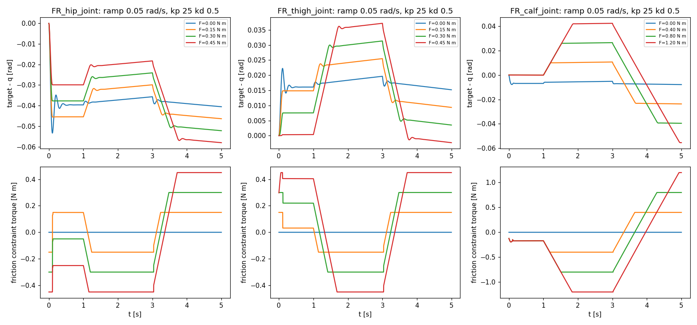
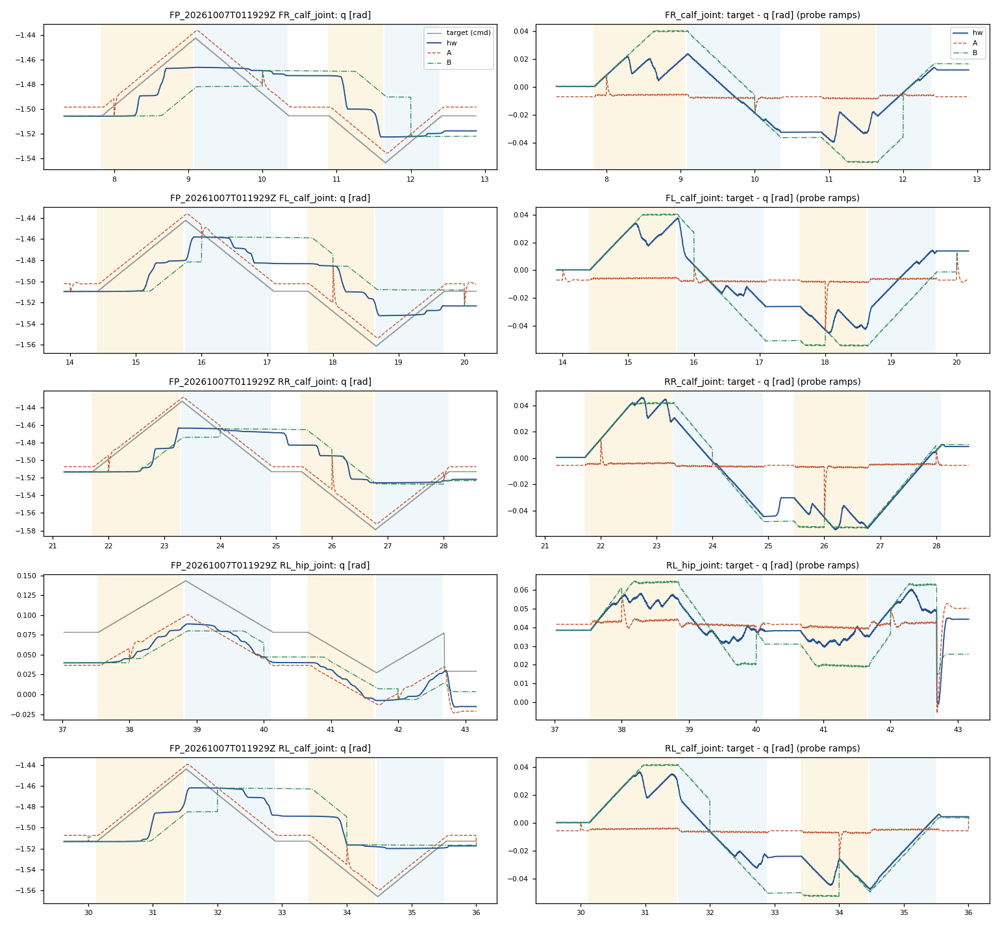

# Model B: joint Coulomb friction, A/B replay on the 2026-10-07 probe sessions

Model B adds one physical term to model A: per-joint-type Coulomb friction, implemented with MuJoCo's
`dof_frictionloss` constraint. Static and kinetic friction are equal (structure B0). The constraint holds
a joint at rest while the net torque is below F, and opposes sliding with F. Everything else is identical
to model A (baseline doc `../2026-10-30_actuator_replay_baseline/`): the same DCMotor PD gains, gravity,
fixed base, 1 ms step, and a reset to the measured state every 2 s. With F = 0, B reproduces A exactly.
Nothing was run on the robot.

Commits: `76a4855` (replay tool, model A baseline), `5b7db1e` (model B, physics checks, preregistration,
train-only fit, frozen parameters), `5e12aa5` (A/B comparison, post-hoc diagnostics, tests, this doc).
Simulator: MuJoCo 3.17.0 on mewtwo (CPU). Scene: the `unitree_go2/scene.xml` from the friction-deploy worktree.

## Verdict

**ACCEPT under the preregistered rule, with disclosed limits. Not yet ready for Isaac Lab.**

Held-out position and velocity tracking improves on every joint type, and the improvement survives
three controls: an orientation change, a 10 s reset interval, and a locked-joint run. B reproduces
stick and single breakaway events, which A cannot. B does not reproduce the hardware's repeated
stick-slip micro-cycles. It also over-sticks: breakaways are systematically late, and every one of its
break/no-break disagreements with the hardware is a missed breakaway. The per-type stick criterion fails
for the hip, which has only one held-out joint.

## Split and exclusions (frozen before fitting)

- train: `FP_20261007T005239Z`, `005825Z`, `011122Z`, `011645Z`
- held out: `FP_20261007T010358Z`, `011929Z`
- excluded joints: 010358 FR calf, 011122 RL hip, 011645 FR and FL calves

## Configuration and fitted parameters

- Preregistration: `configs/sim2real/actuator_model_B.yaml`. This file holds the structure, bounds, fit
  rule and acceptance rule, and was committed before the held-out run.
- Frozen parameters: `configs/sim2real/actuator_model_B_frozen.yaml`, written by `scripts/fit_model_b.py`
  from the training sessions only.
- Constraint: solref [0.002, 1.0], solimp [0.999, 0.999, 0.001]. This is stiffer than MuJoCo's default,
  so a held joint creeps by less than 1 mrad in 2 s.
- Fit method: an 11-point grid within the bounds, then a 5-point refinement around the best point. The
  objective is the training pos RMSE per type. Cross-type coupling was below 0.1 %, and no value landed
  on a bound.

| type | F frozen [N m] | bounds [N m] | measured on train, Fs/Fk [N m] |
|---|---|---|---|
| hip | 0.522 | [0.13, 0.62] | 0.26 to 0.41 |
| thigh | 0.319 | [0.085, 0.51] | 0.17 to 0.34 |
| calf | 1.15 | [0.31, 1.51] | 0.61 to 1.01 |

The fitted hip and calf values sit above the directly measured range (by about 27 % and 14 %). That is
consistent with the late breakaways in finding 4.

Training pos RMSE [rad], A to B: hip 0.0096 to 0.0034, thigh 0.0089 to 0.0021, calf 0.0257 to 0.0018.

## Physics checks (`scripts/model_b_physics_checks.py`, no hardware data)

- **Holding.** Gravity off, constant torque on one joint for 2 s, using the registered constraint:
  - at 0.5F and 0.9F, drift is at most 0.06 mrad for the hip and thigh, and at most 0.97 mrad for the calf
  - at 1.1F, the joint slides (more than 0.68 rad)

  This is stiction, not damping.
- **Ramp hysteresis.** Kp 25, 0.05 rad/s up/down ramp. The tracking error at breakaway, up plus down,
  matches Coulomb's 2F/kp to within 3 % for hip and thigh F in {0.15, 0.30, 0.45} and calf F in
  {0.4, 0.8}. Changing F changes the response proportionally. At F = 1.2 the calf never breaks away
  within the 0.1 rad ramp, which is expected because 2F/kp is larger than the ramp.
- **Stability.**
  - zero velocity sign changes while held (no chatter)
  - dt 1 ms vs 0.5 ms: maximum difference in q of 0.2 mrad for the hip and 0.05 mrad for the thigh
  - F = 0 is bit-identical to A



## Held-out results (B frozen, evaluated once, no refit)

Per type, mean of the session type means. "%" is the change relative to A. LOCK and reset10 are
**post-hoc controls**: they were not in the preregistration and were added after the first held-out run.
LOCK uses F = 100 N m, which freezes every joint.

| metric | type | A | B | B - A | % | LOCK | A reset10 | B reset10 |
|---|---|---|---|---|---|---|---|---|
| pos RMSE [rad] | hip | 0.0078 | 0.0034 | -0.0044 | -57 | 0.0646 | 0.0079 | 0.0046 |
| pos RMSE [rad] | thigh | 0.0079 | 0.0024 | -0.0054 | -69 | 0.0550 | 0.0080 | 0.0030 |
| pos RMSE [rad] | calf | 0.0245 | 0.0030 | -0.0215 | -88 | 0.0860 | 0.0249 | 0.0049 |
| vel RMSE [rad/s] | hip | 0.0526 | 0.0456 | -0.0070 | -13 | 0.0817 | 0.0490 | 0.0456 |
| vel RMSE [rad/s] | thigh | 0.0477 | 0.0421 | -0.0055 | -12 | 0.0692 | 0.0441 | 0.0422 |
| vel RMSE [rad/s] | calf | 0.0663 | 0.0273 | -0.0390 | -59 | 0.0943 | 0.0392 | 0.0271 |
| steady-state bias, sim - hw [rad] | hip | 0.0021 | -0.0000 | | | | | |
| steady-state bias, sim - hw [rad] | thigh | -0.0050 | -0.0003 | | | | | |
| steady-state bias, sim - hw [rad] | calf | -0.0123 | -0.0002 | | | | | |
| stuck-while-commanded agreement | hip | 0.90 | 0.94 | | | 0.12 | | |
| stuck-while-commanded agreement | thigh | 0.91 | 0.95 | | | 0.12 | | |
| stuck-while-commanded agreement | calf | 0.34 | 0.91 | | | 0.83 | | |
| direction residual split [rad] | hip | 0.025 | -0.002 | | | | | |
| direction residual split [rad] | thigh | 0.019 | 0.003 | | | | | |
| direction residual split [rad] | calf | 0.027 | 0.003 | | | | | |

On the probe ramps, the RMSE of tau_sim minus tau_est [N m] is:

| type | A | B |
|---|---|---|
| hip | 0.22 | 0.30 |
| thigh | 0.23 | 0.17 |
| calf | 0.59 | 0.36 |

tau_est is the motor's current-based estimate. It does not measure joint-side friction, so this metric is
weak evidence in either direction.

Per-joint values, train-split tables and orientation runs are in `logs/actuator_s2r/model_B/compare/compare.md`.



The figure shows held-out session 011929 with hardware, A, B and the command on the probe ramps.
Yellow marks rise and blue marks fall.

## Findings

1. **Position and velocity: improved on every type.**
   - pos RMSE falls 57 % (hip), 69 % (thigh) and 88 % (calf).
   - vel RMSE falls 12 to 59 %.
   - A's direction-dependent residual and steady-state bias almost disappear.

   The gain is not trivial freezing, because LOCK is 8 to 25 times worse than A. It is also not a
   by-product of the 2 s reset, because reset10 keeps the gain.
2. **Orientation does not matter at this resolution.**
   - Setup: each session's recorded tilt (1.25 to 4.22 degrees) was applied as plus and minus pitch and
     roll, to both A and B.
   - Result: held-out pos RMSE changes by at most 0.00035 rad. The A to B change is 0.0044 to 0.0215 rad,
     15 to 196 times larger.
   - Limit: only a scalar tilt magnitude is logged, so the roll/pitch split is unknown. The
     fixed-base replay cannot capture base motion, but these sessions have the base hung.
3. **Preregistered acceptance.**
   - pos RMSE improved by at least 10 % on 3 of 3 types, with no regressions.
   - Pooled breakaway timing error: A 0.465 s, B 0.213 s, a 54 % drop against a required 30 %.
   - Pooled error at breakaway: hw 0.028 rad, B 0.037 rad, +31 % against a required limit of 50 %.
   - Orientation does not confound the result.

   Rule result: **ACCEPT**. A stricter per-type reading fails the hip:
   - Timing error is 30 % worse than A.
   - Error at breakaway is +127 % worse. Part of this is an artifact: the registered metric is a signed
     mean, and on the hip the signed mean is close to 0.
   - The held-out hip evidence is a single joint, 011929 RL hip, with 4 ramps.
4. **Stick-slip is reproduced only partly. B over-sticks.** (post hoc, disclosed here)
   - The registered timing metric only scores ramps where both the hardware and the sim broke away, so
     it hides missed breakaways.
   - Counting per ramp, B breaks away on 0 of 8 held-out calf "fall" ramps. The hardware breaks away on
     3 of those 8, and A breaks away on all 8.
   - Agreement with the hardware on break/no-break:

     | data | A | B |
     |---|---|---|
     | held out | 19/24 | 21/24 |
     | train | 30/32 | 27/32 |

   - Every B disagreement is a miss (stuck when the hardware broke away). Every A disagreement is a
     false breakaway.
   - On ramps where both broke, B is late on average by 0.35 s (hip), 0.08 s (thigh) and 0.13 s (calf).
     These are the held-out reset10 numbers. The break/no-break counts are identical under reset10, so
     the breakaways are not reset artifacts.
   - The hardware calves show repeated stick-slip micro-cycles: a staircase of small slips at a tracking
     error of 0.02 to 0.04 rad. B cannot produce these with Fs = Fc. It shows one stick followed by one
     slide.
   - Likely cause: a pos-RMSE objective under 2 s resets rewards holding the joint near its last measured
     state, so it pushes F above the measured breakaway friction (see the parameter table).
5. **Isaac Lab readiness: not yet.**
   - The bias toward late breakaways would make a trained policy expect more stiction than the robot has.
   - PhysX joint friction is a different model from MuJoCo's soft constraint. Transferring F would need its
     own replay check in Isaac.
   - The held-out stick evidence is thin: 1 hip joint, 1 thigh joint and 4 clean calves.

## Single next experiment

Run a new hung-robot probe session on hardware: up/down ramps on all 12 joints at two ramp rates, with
the base hung and nothing else changed. Then evaluate two models on it, preregistered, once each:
- the frozen B, unchanged
- a B whose F per type is the median of the training-measured breakaway friction (no fitting)

This gives independent held-out stick evidence for hips and thighs, which the current set lacks. It also
tests directly whether the over-stick comes from the fit objective. The two ramp rates show whether
rate-dependent friction (the micro-cycles) needs a Stribeck term. This experiment requires physical
motor commands, so it has not been run.

## Reproduce

```
V=<python with mujoco 3.17>; SC=<.../unitree_go2/scene.xml>; D=<.../phoenix-walk-v1-hw/logs/hw_sessions>
export PYTHONPATH=src
c="--split configs/sim2real/actuator_replay_split.yaml --data-root $D --scene $SC --dt 0.001 --cache logs/actuator_s2r/baseline_A/cache"
$V scripts/model_b_physics_checks.py --scene $SC --config configs/sim2real/actuator_model_B.yaml --out logs/actuator_s2r/model_B/physics_checks
$V scripts/fit_model_b.py --data-root $D --scene $SC --cache logs/actuator_s2r/baseline_A/cache --out logs/actuator_s2r/model_B/fit --frozen configs/sim2real/actuator_model_B_frozen.yaml
E=logs/actuator_s2r/model_B/eval
$V scripts/actuator_replay.py $c --save-sim --label A --out $E/A_level
$V scripts/actuator_replay.py $c --save-sim --model-b configs/sim2real/actuator_model_B_frozen.yaml --label B --out $E/B_level
$V scripts/actuator_replay.py $c --save-sim --model-b configs/sim2real/actuator_model_B.yaml --frictionloss 100,100,100 --label LOCK --out $E/LOCK_level
# orientation: add --tilt pitch+|pitch-|roll+|roll- to the A and B runs (out $E/{A,B}_<tilt>)
# reset10: add --reset-s 10 (out $E/{A,B,LOCK}_reset10, and with --save-sim --no-plots to $E/{A,B}_reset10_sim)
$V scripts/compare_model_b.py --eval $E --cache logs/actuator_s2r/baseline_A/cache --config configs/sim2real/actuator_model_B.yaml --out logs/actuator_s2r/model_B/compare
```

Tests: `pytest tests/test_actuator_replay.py` (10 tests). These include a one-hinge MuJoCo check that
frictionloss holds a joint at 0.5F and 0.9F and lets it slide at 1.1F.

## Assumptions and limits

- The base is welded. The hung sessions have no foot contact, except for the excluded floor-contaminated
  joints.
- Structure B0 (Fs = Fc) was chosen from the training Fs/Fk ratios, whose median is 0.93. The hardware
  micro-cycles suggest velocity-weakening friction that these ratios did not resolve.
- The 2 s reset protects both models from drift. The reset10 control shows the ranking does not depend on it.
- The LOCK, reset10, per-ramp breakaway counts and signed-lateness numbers were all added after the
  held-out run. None of them changed a parameter.
